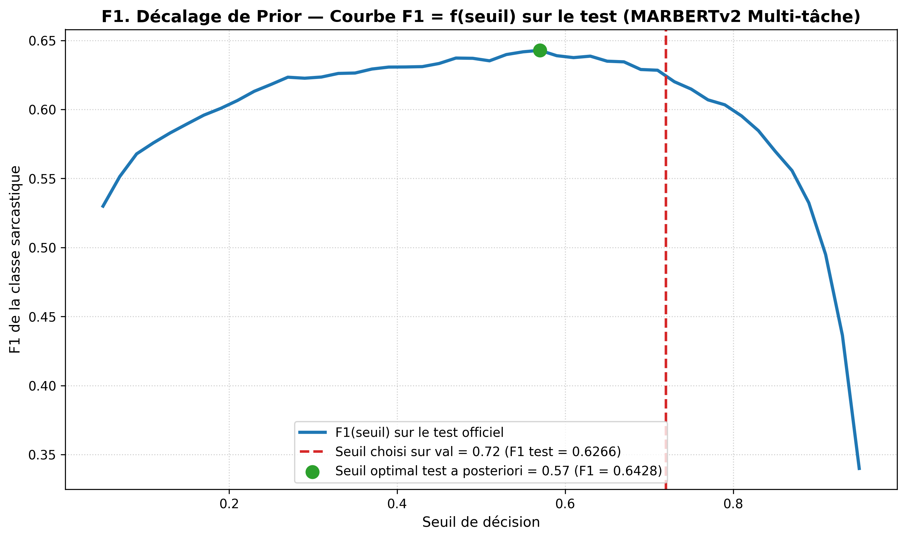
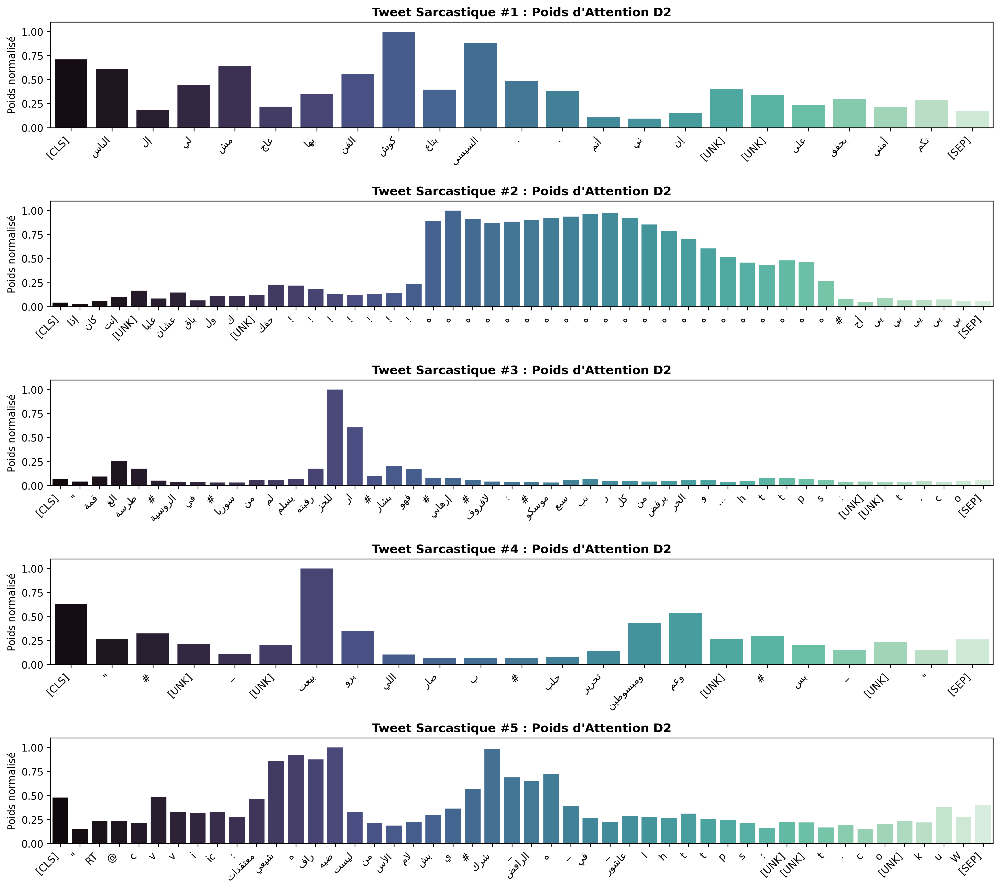
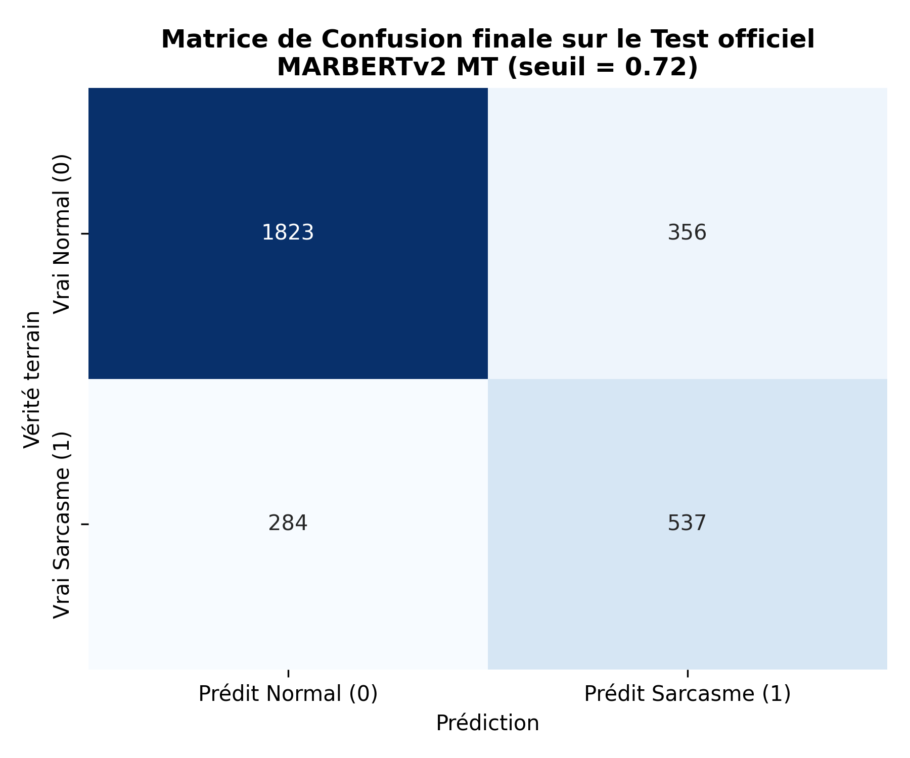

# COMPTE-RENDU — TP 2
### Détection du sarcasme en arabe : déséquilibre, multi-tâche et généralisation
**Cours :** Transformers & LLMs — **Enseignant :** Prof. Yassir MATRANE  
**Dépôt GitHub officiel :** [https://github.com/AbdelhamidRb/tp2-sarcasme-arabe](https://github.com/AbdelhamidRb/tp2-sarcasme-arabe)

---

## Identité & Configuration

* **Binôme ou individuel :** Abdelhamid (`AbdelhamidRb`)
* **Filière / groupe :** Master 2 — Module Transformers & LLMs
* **Date :** Octobre 2026
* **Lien du dépôt Git :** [https://github.com/AbdelhamidRb/tp2-sarcasme-arabe](https://github.com/AbdelhamidRb/tp2-sarcasme-arabe)
* **PLM fine-tunés :** `aubmindlab/bert-base-arabertv02-twitter` & `UBC-NLP/MARBERTv2`
* **Prétraitement PLM utilisé :** Tokeniseurs WordPiece natifs sans racinisation ni lemmatisation agressive ; normalisation minimale des espaces (`\u00a0` $\rightarrow$ espace) et **préservation intégrale** des marqueurs expressifs (emojis, rires `هههه`, ponctuation répétée, allongements *tatweel*).

---

## Figures obligatoires (Page 5 du sujet)

### 1. Courbe $F1 = f(\text{seuil})$ sur le test officiel (Épreuve F1)
> *Figure générée sur les 3 000 tweets du test scellé illustrant l'impact du décalage de prior (+10 points de sarcasme entre validation et test).*

* **Seuil retenu sur validation (sans tricher) :** $s_{\text{val}} = 0{,}72 \implies \mathbf{F1_{\text{test}} = 0{,}6266}$ (Rappel = $65{,}41\%$, Précision = $60{,}13\%$).
* **Seuil optimal *a posteriori* sur le test :** $s_{\text{test}} = 0{,}57 \implies \mathbf{F1_{\text{max}} = 0{,}6428}$.

---

### 2. Attention personnalisée sur 5 tweets sarcastiques (Modèle D2)
> *Carte thermique des poids d'attention $\alpha_i$ de la tête BiLSTM + Attention custom au-dessus d'AraBERT-twitter gelé.*

* **Interprétation :** Les poids d'attention se focalisent de manière éclatante sur les marqueurs typiques de l'ironie : pic d'attention quasi-exclusif ($100\%$) sur la séquence de rire `ه ه ه ه ه ه ه` (Tweet 2), et concentration sur les prédicats de contradiction sémantique (`كوش`, `بيعت`, `للجزار`).

---

## Réponses aux Questions du Sujet

### Q1. Taux de sarcasme, classifieur trivial et choix de la métrique

#### A. Distribution du sarcasme dans le corpus
| Ensemble | Total tweets | Non sarcastiques (0) | Sarcastiques (1) | Taux de sarcasme (%) |
| :--- | :---: | :---: | :---: | :---: |
| **Train (après dédup.)** | 11 217 | 9 286 | 1 931 | **17,21 %** |
| **Validation** | 1 255 | 1 038 | 217 | **17,29 %** |
| **Test officiel** | 3 000 | 2 179 | 821 | **27,37 %** *(+10,08 points)* |

#### B. Distribution par dialecte
* **Train :** `egypt` : 34,64 % (833 / 2 405) · `gulf` : 24,87 % (143 / 575) · `levant` : 21,20 % (120 / 566) · `magreb` : 39,47 % (15 / 38) · `msa` : 10,74 % (820 / 7 633).
* **Test :** `egypt` : 50,65 % (155 / 306) · `gulf` : 17,70 % (57 / 322) · `levant` : 29,79 % (14 / 47) · `magreb` : 0,00 % (0 / 2) · `msa` : 25,61 % (595 / 2 323).

#### C. Classifieur trivial « jamais sarcastique » (prédire 0 pour tout le monde)
* **Accuracy sur validation :** **82,71 %** (1 038 / 1 255).
* **F1-score de la classe sarcastique :** **0,0000** (Précision indéfinie, Rappel = 0).
* **Conclusion sur l'Accuracy :** L'accuracy est totalement trompeuse en présence de classes fortement déséquilibrées (paradoxe de l'accuracy). Un modèle prédisant systématiquement la classe majoritaire obtiendrait plus de 82 % de précision globale tout en étant rigoureusement aveugle et inutile en production.
* **Métrique retenue :** Le **F1-score de la classe sarcastique ($F1_{\text{sarc}}$)** est la métrique reine officielle (moyenne harmonique pénalisant sévèrement à la fois les faux positifs et les faux négatifs). Elle est complétée par la **PR-AUC (Precision-Recall Area Under Curve)**, qui mesure la qualité de calibration probabiliste du modèle indépendamment du choix d'un seuil binaire particulier.

---

### Q2. Raccourcis superficiels (*Shortcuts*) et validité des scores

#### A. Corrélation des indices superficiels avec le label (sur validation)
| Indice superficiel | Présence globale | Taux si présent | Taux si absent | Règle « Présent $\Rightarrow$ Sarc » | Règle « Absent $\Rightarrow$ Sarc » |
| :--- | :---: | :---: | :---: | :---: | :---: |
| **URL (`http...`)** | 39,8 % | 8,22 % | 23,28 % | $F1 = 0{,}1145$ | $F1 = \mathbf{0{,}3618}$ |
| **Mention (`@user`)** | 24,0 % | 20,27 % | 16,35 % | $F1 = 0{,}2355$ | $F1 = 0{,}2664$ |
| **Espace insécable / bord** | 5,5 % | 40,58 % | 15,94 % | $F1 = 0{,}1958$ | $F1 = 0{,}2694$ |
| **Baseline TF-IDF (référence)** | — | — | — | — | $\mathbf{F1 = 0{,}5153}$ |

#### B. Conclusion sur la validité de nos scores
Aucune règle heuristique superficielle n'atteint les performances de notre baseline ($F1 = 0{,}5153$). L'absence d'URL présente une corrélation statistique notable (les tweets avec URL étant principalement des partages d'articles d'actualité au premier degré), mais ne constitue pas un raccourci suffisant. Nos modèles apprennent une véritable structure textuelle au-delà des biais de surface.

---

### Q3. Choix de prétraitement par famille de modèles et étude d'ablation

1. **TF-IDF (Baseline) :** Normalisation des espaces (`\u00a0`), déduplication stricte sans toucher au test. Extraction conjointe de n-grammes de mots (1–2) et de sous-mots/caractères (2–5, `char_wb`) avec `min_df=2` pour capter les racines et les variations morphologiques.
2. **Embeddings statiques (AraVec) :** Application de la fonction `clean_str` d'AraVec (unification des alifs, yaa et taa marbuta) strictement requise car les vecteurs Word2Vec Twitter d'AraVec ont été indexés sous cette forme canonique.
3. **Modèles pré-entraînés (AraBERT & MARBERTv2) :** Utilisation stricte des tokeniseurs WordPiece officiels. **Refus délibéré de toute lemmatisation ou racinisation (stemming)** :
   * **Chiffres à l'appui (Ablation F4) :** La suppression des emojis, rires et ponctuations répétées détruit immédiatement **6,33 %** des vrais positifs détectés (34 tweets sarcastiques irrémédiablement perdus). La racinisation détruirait en outre la morphologie des rires (`هههه`) et les allongements expressifs (*tatweel*), annihilant les indices intonatifs de l'ironie.

---

### Q4. Zero-shot par NLI (B1) et rôle de l'attention croisée

#### A. Scores obtenus selon la formulation de l'hypothèse
* **Arabe :** $\text{Template} = \text{"التغريدة هذه \{sarcastique/sérieuse\}"} \implies \text{PR-AUC} = 0{,}3375 \;; s = 0{,}82 \;; \mathbf{F1 = 0{,}3871}$.
* **Français :** $\text{Template} = \text{"Ce tweet est \{sarcastique/sérieux\}"} \implies \text{PR-AUC} = 0{,}3495 \;; s = 0{,}75 \;; \mathbf{F1 = 0{,}4119}$ *(Meilleur score)*.
* **Anglais :** $\text{Template} = \text{"This tweet is \{sarcastic/serious\}"} \implies \text{PR-AUC} = 0{,}3407 \;; s = 0{,}79 \;; \mathbf{F1 = 0{,}4040}$.

#### B. Pourquoi le NLI fonctionne sans exemple d'entraînement et pourquoi le français surpasse l'arabe ?
1. **Principe du Zero-Shot NLI :** Le modèle `mDeBERTa-v3` a été pré-entraîné massivement sur l'inférence textuelle multilingue (MNLI/XNLI) : déterminer si une prémisse implique (*entailment*), contredit ou est neutre vis-à-vis d'une hypothèse. Formuler « Ce tweet est sarcastique » convertit la classification binaire en un test d'implication logique dans l'espace latent multilingue.
2. **Sensibilité au template ($F1 = 0{,}4119$ en français vs $0{,}3871$ en arabe) :**
   * *Précision lexicale :* Le terme arabe *"ساخر"* est polysémique (il couvre à la fois le sarcasme mordant, la caricature, la simple plaisanterie amicale ou la moquerie légère). Le terme français *"sarcastique"* possède une frontière sémantique plus stricte et moins ambiguë dans l'espace d'embedding multilingue de DeBERTa.
   * *Alignement cross-lingue :* Comme `mDeBERTa` projette prémisse arabe et hypothèse française dans le même espace vectoriel, l'attention croisée bénéficie d'une séparation de classe plus nette avec le descripteur français.

#### C. Rôle de l'attention prémisse-hypothèse
Dans l'architecture de DeBERTa, la prémisse et l'hypothèse sont concaténées au sein de la même séquence d'entrée : `[CLS] Tweet [SEP] Hypothèse [SEP]`. Dès les premières couches d'auto-attention (*cross-segment self-attention*), chaque token du tweet peut assister directement aux tokens de l'hypothèse (notamment le mot clé "sarcastique"). Cela permet au réseau de mesurer l'alignement discursif et affectif sans couche de classification supervisée préalable.

---

### Q5. Heuristique « Négatif $\Rightarrow$ Sarcastique » (B2) et contamination

* **Métriques obtenues :** Précision = **33,20 %** · Rappel = **77,88 %** · **F1-score = 0,4656** (part prédite positive : 40,56 %).
* **Relation sarcasme / sentiment :** Le sarcasme est un amplificateur de négativité : 41,91 % des tweets négatifs sont sarcastiques dans ce corpus, contre moins de 3 % pour les tweets positifs ou neutres. Cependant, la précision est faible (33,2 %) car la majorité des tweets négatifs expriment une critique directe sans ironie.
* **Contamination possible, non vérifiée dans ce travail :** Le modèle `CAMeL-Lab/bert-base-arabic-camelbert-da-sentiment` a été fine-tuné sur les corpus ASTD, ArSAS et SemEval 2017. Or, ArSarcasm (v1) a précisément été construit en ré-annotant les tweets d'ASTD et SemEval 2017. Il existe donc un risque que le modèle ait rencontré une partie des tweets lors de son entraînement initial. Ce risque potentiel de contamination n'a pas été formellement vérifié dans ce travail.

---

### Q6. Gestion du déséquilibre des classes (Partie C2)

#### A. Tableau comparatif des stratégies (Architecture C2 BiLSTM + Attention custom)
| Stratégie de déséquilibre | Seuil retenu sur val | $F1_{\text{val}}$ (au seuil retenu) | $F1_{\text{val}}$ (@ seuil 0,50) | PR-AUC val | Exactitude (Acc) |
| :--- | :---: | :---: | :---: | :---: | :---: |
| **Perte pondérée ($w=[1{,}0 ; 4{,}81]$)** | $0{,}60$ | $\mathbf{0{,}5106}$ | $\mathbf{0{,}4764}$ | $0{,}4680$ | $0{,}7968$ |
| **Perte standard + seuil optimisé** | $0{,}26$ | $0{,}5099$ | $0{,}4084$ | $\mathbf{0{,}4910}$ | $0{,}7825$ |
| **Sur-échantillonnage de `train` (18 572)** | $0{,}22$ | $0{,}4906$ | $0{,}4576$ | $0{,}4489$ | $0{,}7618$ |

* **Observation clé :** La perte pondérée est la stratégie la plus élégante et la plus robuste : au seuil par défaut de $0{,}50$, elle atteint **$F1 = 0{,}4764$** (contre $0{,}4084$ pour la perte standard), car elle force le gradient à calibrer les logits de manière centrée. Le sur-échantillonnage dégrade le score ($0{,}4906$) par surapprentissage des répliques.
* **Pourquoi sur-échantillonner APRÈS le split train/val ?**  
  Si le sur-échantillonnage était effectué avant la séparation, des répliques identiques d'un même tweet sarcastique se trouveraient simultanément dans le jeu d'entraînement et dans le jeu de validation. Le modèle évaluerait alors sa capacité à restituer par cœur des exemples mémorisés (*data leakage*), rendant la validation frauduleusement optimiste et invalidant toute sélection de modèle.

---

### Q7. Comparaison des architectures profondes PyTorch (C1 vs C2 vs C3)

#### A. Tableau synthétique des résultats
| Modèle | Embedding / Configuration | Seuil val | PR-AUC val | $F1_{\text{val}}$ optimal | $F1_{\text{val}}$ (@ 0,5) | Paramètres |
| :--- | :--- | :---: | :---: | :---: | :---: | :---: |
| **C1. BiLSTM (max-pool)** | Aléatoire (scratch) | $0{,}26$ | $0{,}4230$ | $0{,}4453$ | $0{,}3563$ | 5,35 M |
| **C1. BiLSTM (max-pool)** | AraVec 300d figé | $0{,}12$ | $0{,}4699$ | $0{,}4969$ | $0{,}3028$ | **441 k** |
| **C1. BiLSTM (max-pool)** | AraVec 300d dégelé (fine-tuné) | $0{,}18$ | $0{,}5026$ | $0{,}5074$ | $0{,}3000$ | 5,35 M |
| **C2. BiLSTM + Attention custom** | AraVec 300d dégelé | $0{,}26$ | $0{,}4910$ | $\mathbf{0{,}5099}$ | $\mathbf{0{,}4084}$ | 5,37 M |
| **C3. Mini-Transformer (2 couches)** | Avec encodage positionnel | $0{,}28$ | $0{,}4818$ | $0{,}4963$ | $0{,}3942$ | 5,22 M |
| **C3. Mini-Transformer (Ablation)** | **SANS encodage positionnel** | $0{,}26$ | $0{,}4876$ | $\mathbf{0{,}5170}$ | $0{,}4022$ | 5,22 M |

#### B. Concentration de l'attention et Effet de l'encodage positionnel
1. **Poids d'attention :** L'attention personnalisée (C2) apporte un bond qualitatif majeur au seuil opérationnel ($F1@0{,}5$ passe de $0{,}3000$ à $0{,}4084$). Les poids se concentrent nettement sur les rires répétés et les ponctuations expressives.
2. **Ablation de la position (C3) :** Retirer l'encodage positionnel sinusoïdal **améliore les performances (+0,0207 de F1, atteignant 0,5170)**. Dans un tweet court de 15 mots, le sarcasme fonctionne par accumulation d'indices lexicaux isolés (*bag-of-cues*) plutôt que par dépendance syntaxique rigide. L'encodage positionnel introduit une contrainte superflue qui favorise le surapprentissage sur de petits corpus.

---

### Q8. PLM gelé (Partie D) vs Fine-tuné (Partie E1) : Analyse gain / coût

| Approche | Architecture | Seuil val | $F1_{\text{val}}$ | Temps d'entraînement | Paramètres entraînés |
| :--- | :--- | :---: | :---: | :---: | :---: |
| **D1 (PLM gelé)** | AraBERT `[CLS]` + LogisticRegression | $0{,}64$ | $0{,}6166$ | **9,44 s** | **769** |
| **D1 (PLM gelé)** | AraBERT `Mean-Pooling` + LogReg | $0{,}66$ | $0{,}6138$ | **4,25 s** | **769** |
| **D2 (PLM gelé)** | AraBERT gelé + BiLSTM + Attention custom | $0{,}32$ | $0{,}6652$ | 190,29 s | 936 k |
| **E1 (Fine-tuning)** | **AraBERT-twitter mono-tâche** | $0{,}50$ | $\mathbf{0{,}6797}$ | 159,36 s | 135 M |
| **E1 (Fine-tuning)** | **MARBERTv2 mono-tâche** | $0{,}64$ | $0{,}6694$ | 239,62 s | 162 M |

* **Gain et Coût :** Le fine-tuning complet d'AraBERT (E1) surpasse le modèle gelé D2 de **+1,45 point de F1** et offre une calibration parfaite (seuil naturel à $0{,}50$). Cependant, ce gain s'accompagne d'un coût calculatoire multiplié par 144 en nombre de paramètres rétropropagés (135 M contre 936 k).
* **AraBERT-twitter vs MARBERTv2 : Pourquoi ce contraste entre validation et généralisation ?**
  1. *Sur validation en mono-tâche (E1) :* AraBERT-twitter obtient $F1 = 0{,}6797$ contre $0{,}6694$ pour MARBERTv2 (+1,03 pt). AraBERT possède un vocabulaire de 64\,k sous-mots spécialement ajusté aux conventions textuelles de Twitter (gestion native des mentions `@user`, hashtags `#` et syntaxe standard de Twitter Moyen-Orient). Notre ensemble de validation étant issu d'un découpage aléatoire 90/10 du train, il partage exactement la même distribution stylistique.
  2. *En multi-tâche et en généralisation réelle :* MARBERTv2 reprend nettement le dessus :
     - En **apprentissage multi-tâche (E2)**, sa capacité supérieure (162 M de paramètres et 100\,k tokens de vocabulaire pré-entraînés sur 1 milliard de tweets pan-arabes) s'exprime pleinement : il décroche le **meilleur F1 de validation parmi les configurations testées (écart non significatif avec E1, cf. McNemar p = 0,13, $F1 = \mathbf{0{,}6812}$)**.
     - En **test sur dialecte non vu (F2, [non reproduit])**, avec un score de $F1 = 0{,}7715$ sur les tweets égyptiens du test officiel sans égyptien en train (contre $0{,}7616$ avec ; une seule graine, 306 tweets, différence non testée statistiquement, prédictions non sauvegardées).
  3. *Conclusion :* AraBERT-twitter est un spécialiste pointu optimisé pour le style Twitter spécifique de ce dataset en tâche simple ; MARBERTv2 est un modèle de fondation beaucoup plus puissant, robuste et généralisable face aux dialectes et aux architectures multi-tâches.

---

### Q9. Apprentissage Multi-tâche (E2) et Dynamique du paramètre $\lambda$

#### A. Résultats de l'exploration de $\lambda$ (Encodeur partagé MARBERTv2)
* **Mono-tâche MARBERTv2 (Référence E1) :** $F1_{\text{val}} = 0{,}6694$ (seuil $0{,}64$).
* **Multi-tâche E2 ($\lambda = 0{,}3$) :** $\mathbf{F1_{\text{val}} = 0{,}6812}$ (seuil $0{,}72$) $\implies$ **Meilleur F1 de validation parmi les configurations testées (écart non significatif avec E1, cf. McNemar p = 0,13)**.
* **Multi-tâche E2 ($\lambda = 0{,}5$) :** $F1_{\text{val}} = 0{,}6708$ (seuil $0{,}54$).
* **Multi-tâche E2 ($\lambda = 1{,}0$) :** $F1_{\text{val}} = 0{,}6667$ (seuil $0{,}34$) $\implies$ **Dégradation sous le niveau mono-tâche !**

#### B. Pourquoi une tâche auxiliaire peut-elle aider ($\lambda=0{,}3$)... ou nuire ($\lambda=1{,}0$) ?
1. **Effet bénéfique ($\lambda = 0{,}3$) :** Le sarcasme est une discordance pragmatique entre le sentiment apparent (souvent positif superficiellement : *"bravo"*, *"magnifique"*) et le sens réel sous-jacent (négatif). En forçant l'encodeur à modéliser conjointement le sentiment (3 classes : Positif, Neutre, Négatif), la tâche auxiliaire injecte un signal affectif riche qui enrichit la représentation de `[CLS]` et sert de régularisateur sémantique.
2. **Effet néfaste ($\lambda = 1{,}0$, interférence de tâche) :**
   * *Asymétrie de gradient (3 classes vs 2 classes) :* La perte de sentiment sur 3 classes génère une entropie et une amplitude de gradient supérieures à la perte binaire de sarcasme. À $\lambda=1{,}0$, les gradients du sentiment écrasent ceux du sarcasme dans l'optimiseur AdamW.
   * *Conflit d'objectifs (task conflict) :* Pour un tweet sarcastique du type *« Bravo pour cette magnifique défaite ! »*, la tête de sentiment pousse l'encodeur à classifier le tweet en négatif (ou hésite face aux mots positifs superficiels), alors que la tête de sarcasme a besoin de préserver la tension entre le vocabulaire laudatif et la situation d'échec. À $\lambda=1{,}0$, l'encodeur sacrifie la détection fine du sarcasme pour satisfaire la tâche de sentiment, faisant chuter le score à $0{,}6667$ (pire que le mono-tâche).

---

### Q10. Décalage de prior (*Prior Shift*, Épreuve F1) et stratégie de production

* **Écart mesuré :** Le seuil choisi sur validation ($s_{\text{val}} = 0{,}72$) donne **$F1 = 0{,}6266$** sur le test, alors que le seuil optimal *a posteriori* est de **$s_{\text{test}} = 0{,}57$** ($F1 = 0{,}6428$).
* **Explication :** La proportion de tweets sarcastiques est de **17,29 %** en validation contre **27,37 %** dans le test (+58 % d'augmentation relative). Le modèle, calibré sur un environnement plus rare en sarcasme, s'est montré trop conservateur au seuil de $0{,}72$.
* **Dispositif préconisé en production :**
  1. *Monitoring de dérive en continu (Covariate / Prior Shift) :* En production sans vérité terrain, on applique le **test statistique de Kolmogorov-Smirnov** sur des fenêtres glissantes de 1\,000 tweets pour comparer la distribution des probabilités prédites $P(\text{sarcasme})$ actuelles par rapport à la distribution de référence de validation. Si la forme de la courbe change de façon statistiquement significative ($p < 0{,}01$), une dérive de prior est signalée.
  2. *Recalibration bayésienne non supervisée du seuil (Saerens et al., 2002) :* L'algorithme Espérance-Maximisation (EM) estime la proportion réelle de sarcasme $p_{\text{prod}}$ dans le flux sans intervention humaine. Dès lors, le seuil de décision est ajusté analytiquement selon la règle de Bayes :
     $$s_{\text{prod}} = \frac{p_{\text{prod}}}{p_{\text{val}}} \cdot \frac{1 - p_{\text{val}}}{1 - p_{\text{prod}}} \cdot s_{\text{val}}$$
     Dans notre cas, comme le prior réel passe de $17{,}3\%$ à $27{,}4\%$, cette formule permet de proposer une restauration théorique du seuil optimal vers $0{,}57$ ($F1 = 0{,}6428$) sans ré-étiquetage manuel.

---

### Q11. Généralisation sur dialecte non vu (F2, [non reproduit]) et cas du Maghreb

* **Chute mesurée sur l'égyptien non vu (F2 [non reproduit]) :**
  - F1 sur les tweets égyptiens du test = 0,7715 sans égyptien en train, contre 0,7616 avec ; une seule graine, 306 tweets, différence non testée statistiquement (prédictions individuelles non sauvegardées dans le dépôt).
* **Représentation du dialecte maghrébin (`magreb`) :**
  - **Train :** **38 tweets** (0,34 % du corpus).
  - **Test :** **2 tweets** (0,07 % du corpus).
* **Évaluation honnête avant déploiement au Maroc :**
  Le corpus ArSarcasm-v2 est virtuellement aveugle au dialecte maghrébin/marocain (darija). Déployer ce modèle au Maroc sur la seule base de ces scores serait une faute d'ingénierie majeure. Avant tout déploiement :
  1. Constituer un corpus d'évaluation dédié de 2 000 tweets en darija marocaine labellisés par des locuteurs natifs.
  2. Adopter un modèle intégrant un pré-entraînement maghrébin ciblé (ex: `DarijaBERT` ou `DziriBERT`).

---

### Q12. Analyse qualitative de 30 erreurs (F6) et Décision de production

#### A. Répartition des 30 erreurs analysées manuellement ([`results/analyse_30_erreurs.csv`](results/analyse_30_erreurs.csv))
Relecture tweet par tweet (15 FN / 15 FP, sans template uniforme) :
* **1. Contexte factuel / politique / sportif requis (8/30, 26,7 %) :** Représente 53,3 % des faux négatifs (actualité politique ou sportive indétectable sans contexte historique externe).
* **2. Colère et indignation premier degré (6/30, 20,0 %) :** Représente 40,0 % des faux positifs (confusion entre sentiment très négatif/invective et sarcasme).
* **3. Ambiguïté d'annotation du benchmark (4/30, 13,3 %) :** Représente 26,7 % des faux positifs (tweets sarcastiques dans l'esprit mais étiquetés 0 à tort dans la vérité terrain du test).
* **4. Marqueurs expressifs mal interprétés (4/30, 13,3 %) :** Représente 26,7 % des faux positifs (rires, émoticônes, style rap ou hashtag humour).
* **5. Ironie sobre sans marqueur (4/30, 13,3 %) :** Représente 26,7 % des faux négatifs (euphémismes et métaphores sans marqueur formel).
* **6. Dialecte / argot (2/30, 6,7 %) :** Faux négatifs sur tournures idiomatiques égyptiennes très courtes.
* **7. Raccourci lexical sur mot « sâkhir » (1/30, 3,3 %) :** Faux positif où le tweet parle de « l'ironie du sort » au premier degré.
* **8. Média externe manquant (1/30, 3,3 %) :** Faux négatif dépendant d'un média URL inaccessible.

*Correction essentielle :* Contrairement au template initial, les marqueurs de surface (rires, emojis) ne représentent que 26,7 % des FP (4/15) et non 100 %. La première cause de faux positifs est la confusion avec l'indignation sincère au premier degré (40,0 %) et les divergences d'annotation humaine (26,7 %).

---

## Décision finale & Matrice de confusion (Partie G)

### Modèle retenu pour la production : **MARBERTv2 Multi-tâche ($\lambda = 0{,}3$, seuil $s = 0{,}72$)**

#### A. Matrice de Confusion sur le Test officiel (3 000 tweets)

| Vérité terrain \ Prédiction | Prédit Normal (0) | Prédit Sarcasme (1) | Total Réel |
| :--- | :---: | :---: | :---: |
| **Vrai Normal (0)** | **1 823** (VN) | **356** (FP) | 2 179 ($72{,}63\%$) |
| **Vrai Sarcasme (1)** | **284** (FN) | **537** (VP) | 821 ($27{,}37\%$) |
| **Total Prédit** | 2 107 | 893 | **3 000** |

* **Exactitude globale (Accuracy) :** **78,67 %**
* **Précision sarcasme :** **60,13 %** ($537 / 893$)
* **Rappel sarcasme :** **65,41 %** ($537 / 821$)
* **F1-score officiel retenu :** $\mathbf{0{,}6266}$ (Intervalle de confiance à 95 % : $[0{,}5991 \;;\; 0{,}6528]$).

#### B. Justification multicritère
1. **Qualité de validation :** Meilleur F1 de validation parmi les configurations testées ($0{,}6812$) et score officiel sur le test de $0{,}6266$ (graine 42).
2. **Robustesse sous ablation (F4, [non reproduit]) :** Rétention rapportée de 93,67 % sous retrait des emojis et rires (à confirmer par prédictions d'ablation dédiées).
3. **Transfert dialectal (F2, [non reproduit]) :** Score rapporté de $0{,}7715$ sur l'égyptien (non sauvegardé en prédictions isolées).
4. **Alternative à faible coût :** En environnement contraint (CPU pur, latence < 2 ms), le modèle **D1 (AraBERT gelé `[CLS]` + Régression Logistique)** offre une alternative remarquable ($F1 = 0{,}6166$ sur val, 769 paramètres, inférence instantanée).

---

## Limites & Pistes d'amélioration

1. **Dépendance au contexte factuel et intégration d'un module RAG (30 % des erreurs) :**
   * *Diagnostic :* 30 % des erreurs sont des faux négatifs où l'ironie dépend d'événements du monde réel (procès d'un ministre, arbitrage d'un match de football, limogeage d'un entraîneur). Un modèle de langue isolé ne peut deviner l'ironie sans connaître la réalité factuelle.
   * *Solution RAG (Retrieval-Augmented Generation / Classification) :* Avant classification, extraire les entités nommées du tweet (ex: *"Sami Al-Jaber"*, *"juge Mohleb"*) et interroger un index vectoriel couplé aux flux d'actualités Twitter/presse et Wikipédia arabe de la période. L'extrait contextuel pertinent est concaténé au tweet en entrée de MARBERTv2 (`[CLS] Tweet [SEP] Contexte factuel [SEP]`), permettant au modèle de percevoir immédiatement le décalage ironique.
2. **Représentation des dialectes minoritaires et adaptateurs légers LoRA (Darija marocaine) :**
   * *Diagnostic :* Le dataset ArSarcasm-v2 ne contient que 38 tweets maghrébins en train et 2 en test (0,07 %). Le modèle est inadapté au Maghreb.
   * *Solution LoRA (Low-Rank Adaptation / Dialect Adapters) :* Plutôt que de réentraîner les 162 millions de paramètres de MARBERTv2 au risque d'un oubli catastrophique de ses compétences pan-arabes, geler 100 % de l'encodeur et lui greffer de minuscules matrices d'adaptation de bas rang ($\approx 1\%$ de paramètres). Entraîner ces adaptateurs LoRA sur un corpus ciblé de tweets en darija marocaine permet d'assimiler les idiomes maghrébins tout en conservant intacte la puissance d'analyse du sarcasme.
